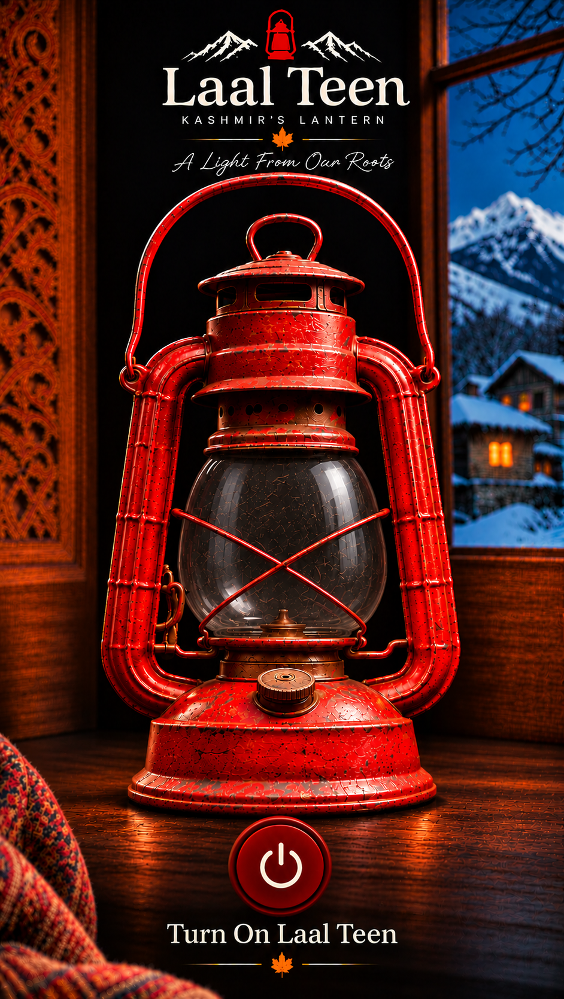
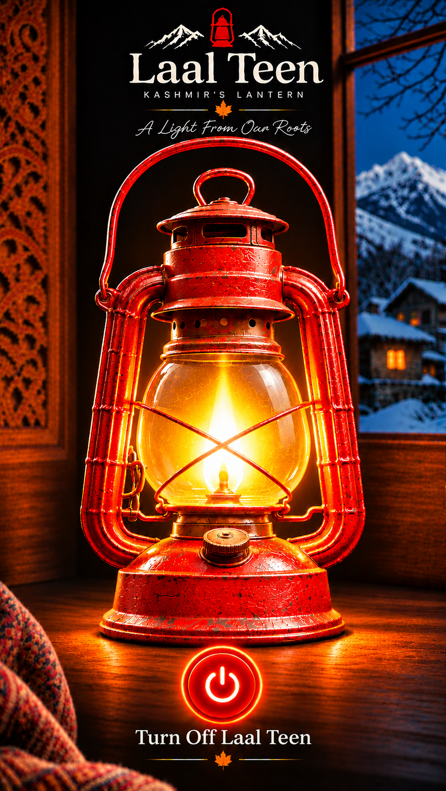

# 🏮 Laal Teen – Kashmir’s Lantern

<p align="center">
  <strong>A Light From Our Roots</strong>
</p>

<p align="center">
  A traditional Kashmiri lantern reimagined as a modern Android flashlight application.
</p>

---

## 📖 About

**Laal Teen** is an Android flashlight application inspired by the traditional red kerosene lantern, commonly known as *Laal Teen* in Kashmir.

The project combines Kashmiri cultural heritage with modern Android technology, bringing a nostalgic symbol of warmth and light to your smartphone.

With a simple tap, users can turn their phone's LED flashlight ON or OFF through an interactive lantern-themed interface.

## ✨ Features

- 🏮 **Kashmiri-inspired design** – Traditional red lantern aesthetics.
- 🔦 **Real LED flashlight** – Controls the device's actual camera flash.
- 🔴 **Interactive interface** – Switches between ON and OFF lantern artwork.
- 🎨 **Custom UI** – High-quality, immersive visual experience.
- 📱 **Simple experience** – Easy-to-use one-tap flashlight control.
- 🌙 **Immersive display** – Full-screen interface for a distraction-free experience.

## 🛠️ Tech Stack

| Technology | Usage |
|---|---|
| Kotlin | Primary programming language |
| XML | UI development |
| Android SDK | Android application development |
| CameraManager | Device flashlight control |
| Android Studio | Development environment |
| Git & GitHub | Version control |

## 📸 Screenshots


## 📱 App Preview


## 📱 App Preview

<table>
  <tr>
    <th>Flashlight OFF</th>
    <th>Flashlight ON</th>
  </tr>
  <tr>
    <td align="center">
      
    </td>
    <td align="center">
      
    </td>
  </tr>
</table>

## 🚀 Getting Started

### Prerequisites

- Android Studio
- Android SDK
- Kotlin support
- An Android device with an LED flash

### Installation

1. Clone the repository:

   ```bash
   git clone https://github.com/akeelshafi/laal-teen.git
   ```

2. Open the project in Android Studio.

3. Allow Gradle to sync.

4. Connect an Android device or start an emulator.

5. Click **Run** to build and launch the application.

## 🔐 Permissions

The application uses the following permission for flashlight functionality:

```xml
<uses-permission android:name="android.permission.CAMERA" />
```

Camera permission is requested at runtime where required by the implementation.

## 📂 Project Structure

```text
LaalTeen/
│
├── app/
│   └── src/
│       └── main/
│           ├── java/com/akeel/laalteen/
│           │   └── MainActivity.kt
│           │
│           ├── res/
│           │   ├── drawable/
│           │   │   ├── laal_teen_on.png
│           │   │   └── laal_teen_off.png
│           │   │
│           │   └── layout/
│           │       └── activity_main.xml
│           │
│           └── AndroidManifest.xml
│
└── README.md
```

## 🎯 Project Vision

Laal Teen is more than just a flashlight application. It is a small attempt to bring a piece of Kashmiri heritage into everyday technology.

The traditional lantern represents warmth, resilience, and the memories of home. This project aims to preserve that feeling through a simple and meaningful Android experience.

## 👨‍💻 Developer

**Akeel Shafi**

- GitHub: [@akeelshafi](https://github.com/akeelshafi)
- LinkedIn: [Akeel Shafi](https://www.linkedin.com/in/akeel-shafi/)

## 📄 License

This project is open source under the MIT License. See the [LICENSE](LICENSE) file for details.

---

<p align="center">
  Made with ❤️ in Kashmir
</p>

<p align="center">
  <strong>Laal Teen – A Light From Our Roots 🏮</strong>
</p>
